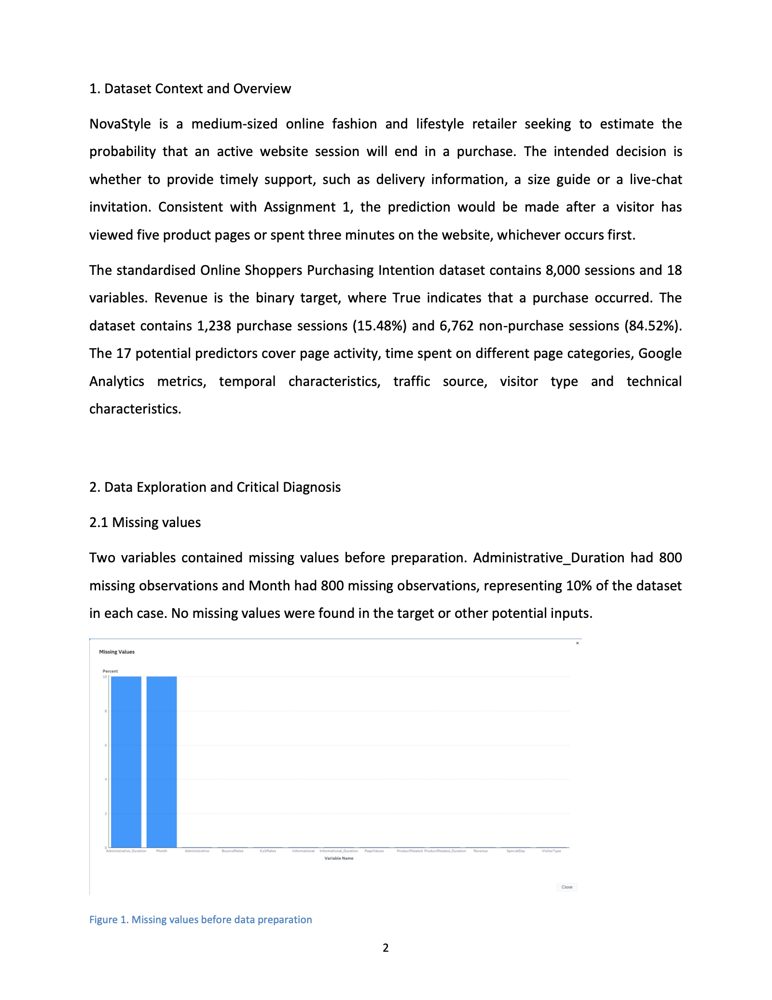
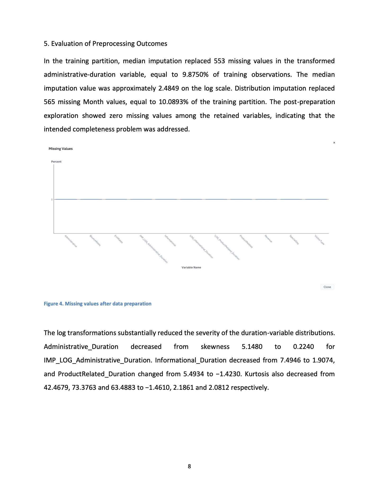

# Preparing online shopping data for purchase-intention modelling

An individual ETW3482 Data Mining and Predictive Modelling assignment completed in 2026. This project examines whether a standardised online shopping dataset is suitable for a proposed in-session purchase-intention prediction task, then implements and evaluates a data-preparation pipeline in SAS Viya Model Studio.

## Project at a glance

- **Question:** How should session data be prepared before comparing purchase-intention models?
- **Working data:** 8,000 sessions, 18 variables, with `Revenue` as the binary outcome. There are 1,238 purchase sessions (15.48%).
- **Tools:** SAS Viya Model Studio for exploration, transformation, imputation and before-and-after checks.
- **Deliverable:** [Public version of the technical report](data-preparation-report-public.pdf). The cover page containing a student ID was removed for public sharing.

## What I did and why

1. **Diagnosed missingness and skewness.** `Administrative_Duration` and `Month` each had 800 missing entries. Three duration variables had long right tails. I also examined 55 exact duplicate rows and kept them because the dataset had no session ID to establish that identical summaries were duplicate records.
2. **Checked prediction-time availability.** The proposed intervention would occur during an active session, but `PageValues` in the supplied completed-session dataset might reflect information unavailable at that decision point. I therefore rejected it as a potential temporal leakage risk. Other retained behavioural inputs would also need to be reconstructed from events available at the actual decision point before deployment.
3. **Built a SAS preparation pipeline.** I applied `log(x+1)` to three duration variables, then used median imputation for transformed administrative duration and distribution imputation for `Month`. Transforming before imputing administrative duration ensured that the replacement value was chosen on the log scale. I used a stratified 70/30 training-validation partition to preserve the minority purchase class.
4. **Evaluated the changes.** The post-preparation exploration showed no missing values among retained inputs, and the transformed duration distributions had less severe upper tails. Some skewness remained. No predictive model was run in this assignment, so these checks support modelling readiness, **not** a claim of improved predictive accuracy.

## Evidence from the report

### SAS data-preparation pipeline

### Missing values before and after preparation

## Files

- [`data-preparation-report-public.pdf`](data-preparation-report-public.pdf): technical report without its original cover page.
- [`standardised-online-shoppers.csv`](standardised-online-shoppers.csv): assignment working dataset, standardised from the UCI source using the course tool. This is **not** the final processed dataset; the transformations and imputation were performed in SAS Viya Model Studio.
- Three PNG images: selected pages from the report showing the pipeline and missing-value checks.

## Data source and scope

The source is the [Online Shoppers Purchasing Intention Dataset](https://archive.ics.uci.edu/dataset/468/online+shoppers+purchasing+intention+dataset) by Sakar and Kastro (2018), DOI: [10.24432/C5F88Q](https://doi.org/10.24432/C5F88Q), licensed [CC BY 4.0](https://creativecommons.org/licenses/by/4.0/). The CSV here is an adapted working version generated for the assignment and contains controlled data-quality issues, so its statistics should not be attributed to the unmodified UCI file.

The business name and intervention scenario in the report are a project context, not a deployed system or measured business result. The report identifies a possible prediction-time issue; resolving it would require time-stamped operational data. No claim of real-world deployment or predictive performance is made.
